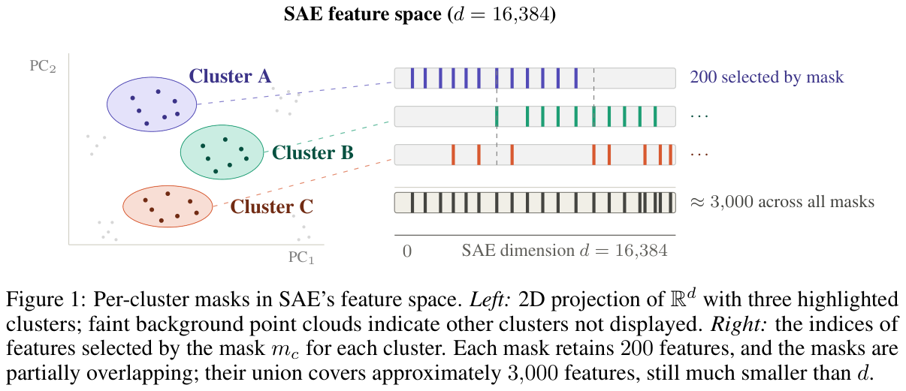

# Local Sparsity Enables Unsupervised LLM Safety Detection

Official code release for the paper *Local Sparsity Enables Unsupervised LLM
Safety Detection*.



## What is in this repository

Nine anomaly-detection methods, all sharing one interface, one config system
and one evaluation path:

| method | config name | space |
|---|---|---|
| FreqMask-KM | `cvdd_kmeans_masked` | SAE features |
| LearnedMask | `learned_mask` | SAE features |
| LearnedMask-LoRA | `learned_mask_lora` | SAE features |
| CVDD | `cvdd` | activations |
| Deep SVDD | `deep_svdd` | activations |
| Gaussian mixture | `gmm` | activations |
| Mahalanobis | `mahalanobis` | activations |
| One-class SVM | `one_class_svm` | activations |
| BCE (supervised reference) | `bce` | SAE features |

FreqMask-KM and LearnedMask (with or without LoRA) are the proposed methods,
which exploit local low-dimensional safety information; the rest are the
baselines they are compared against. Also included: sparse-autoencoder training
and inference, residual-stream activation extraction, the dataset and model
registries, and the evaluation harness.

## Getting started

**[`docs/GETTING_STARTED.md`](docs/GETTING_STARTED.md) is the manual.** It walks
through the whole pipeline in order: install, extract activations for a model,
register a new dataset or model, train an SAE, run a method, and read the
results. Start there if you want to *use* this code.

```bash
conda create -n unsupervised-llm-safety python=3.11 -y
conda activate unsupervised-llm-safety
pip install -e ".[all]"
```


## Layout

```
reference_scores/  the per-sample anomaly scores behind the reported numbers
  compute_metrics.py  recompute the reported metrics from them
  scores/             one .npz + .json per model/method/seed
  expected/           the values the recomputation is checked against
src/unsupervised_llm_safety/
  anodet_algos/   the nine detectors and the evaluation entry point
  models/         sparse autoencoders, model registry
  data/           dataset registry, loaders, activation extraction
  analysis/       metrics and diagnostics
exp_configs/    Hydra configuration
scripts/        extraction, training and sweep drivers
tests/
```

## Licence

Everything in this repository is **MIT** (`LICENSE`).

The per-sample scores under `reference_scores/scores/` were computed over
upstream corpora that carry their own terms. BeaverTails and Alpaca are
CC-BY-NC 4.0 and ARC is CC-BY-SA 4.0, so consult those before redistributing
work derived from them.
